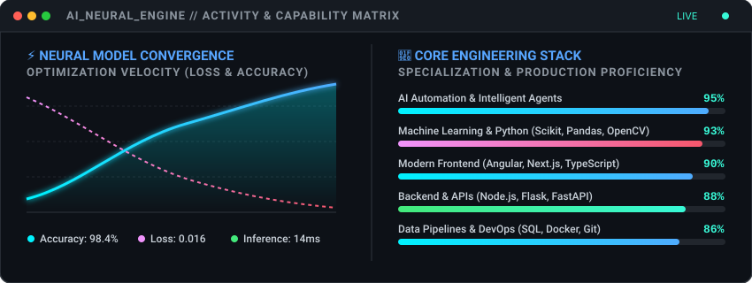

  

<table border="0" width="100%">
  <tr>
    <td width="60%" valign="top">
      <h2>⚡ Hello World, I'm Naitik 👋</h2>
      

        🎓 <b>AI & Data Science Student</b> actively engineering solutions as part of an <b>Industry AI Team</b>. 
        Architecting <b>Autonomous AI Agents</b>, predictive <b>Machine Learning pipelines</b>, and high-performance <b>Full Stack Applications</b>.
      

      

        
        
        
      

    </td>
    <td width="40%" align="center" valign="middle">
      
    </td>
  </tr>
</table>

---

### 💻 AI System Diagnostics

``python
class AIEngineer:
    def __init__(self):
        self.identity = "Naitik Pareek"
        self.academic = "Artificial Intelligence & Data Science (AI & DS)"
        self.role = "AI Team Member @ Production Systems"
        self.domains = ["Autonomous AI Agents", "Machine Learning", "Full-Stack AI"]
        self.stack = ["Python", "Angular", "Next.js", "Node.js", "OpenCV"]
        self.status = "Optimizing models and building autonomous agent pipelines 🚀"
``

---

### 📊 AI Analytics & Capability Matrix

  

---

### 🛠️ Core Engineering Stack

  <b>🤖 AI, ML & DS:</b>
  
  
  
  
  
  

  <b>🌐 Full Stack:</b>
  
  
  
  
  

  <b>🗄️ Infra & Tools:</b>
  
  
  
  
  

---

### 🧬 Autonomous System Architecture

`mermaid
graph LR
    A[Data Stream / Input] --> B[AI Automation Agent]
    B --> C[ML & Neural Model Inference]
    C --> D[Angular / Next.js Full Stack UI]
`

---

  

